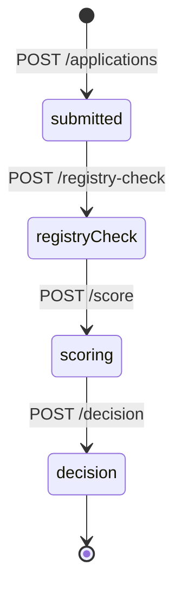

# Состояния заявки

В колонке `portal.applications.step` четыре значения. Вопросы, выписка и поиск товаров шаг не двигают.

| Шаг | Подпись в кабинете | Что уже есть в заявке |
| --- | --- | --- |
| `submitted` | Заявка подана | Цель, сумма, срок, ИНН, ОГРН или ОГРНИП, заявленные финансы и названия документов |
| `registryCheck` | Проверка ФНС и БКИ | Снимки МСП, Федресурса, арбитража, ФНС и БКИ |
| `scoring` | Кредитный скоринг | Балл, решение модели, код продукта, потолок и сумма к выдаче |
| `decision` | Решение банка | Решение сотрудника: `approve`, `review` или `reject`, комментарий и время |

Повторный скоринг после записанного решения сотрудника возвращает конфликт. Пока решения сотрудника нет, скоринг можно пересчитать, и шаг снова станет `scoring`.

Решение модели и решение сотрудника — разные поля:

| Поле | Значения | Кто пишет |
| --- | --- | --- |
| `score_decision` | `approve`, `review`, `reject` | балльная таблица |
| `employee_decision` | `approve`, `review`, `reject` или пусто | сотрудник банка |

`approve` и `review` сотрудника возможны только после сохранённого скоринга. `reject` можно записать и без балла.

Уточнение — это строка в `portal.information_requests`, а не отдельный шаг. Пока `answered_at` пустой, вопрос открыт. Сценарий «Запрос уточнения» в кабинете открывает такую заявку.
