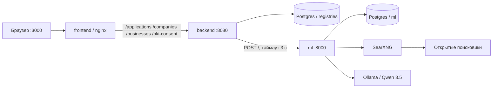

# Архитектура

Один процесс от потребности в финансировании до результата по заявке. Клиент и сотрудник банка смотрят одну и ту же заявку в PostgreSQL. Роли с паролем нет: режим переключается в шапке кабинета.

| Сервис | Роль |
| --- | --- |
| `frontend` | React-кабинет. nginx отдаёт сборку и проксирует API |
| `backend` | Заявка, реестры, баллы, решение сотрудника, вопросы, выписка |
| `postgres` | Две базы: `registries` и `ml` |
| `ml` | Подбор товаров под сумму кредита |
| `searxng` | Метапоиск страниц магазинов |
| `ollama` | Локальная модель с открытыми весами |
| `ollama-pull` | Один раз скачивает модель и завершается |

Postgres, SearXNG и Ollama в `docker compose up` наружу не публикуются. Наружу открыты кабинет `3000`, API `8080` и ML `8000`.

## Граница процесса

Внутри продукта: выбор цели и продукта, заявка, проверка реестров, скоринг, вопрос клиенту, выписка, решение сотрудника, статус для клиента, ссылки на товары.

За границей, явно: электронная подпись, перевод денег, настоящие счета, корпоративные системы Альфа-Банка, новостная лента.

## Как связаны модули

1. Кабинет читает карточку компании из `GET /companies/{inn}` и `GET /businesses/{ogrn}`.
2. `POST /applications` сохраняет заявку и просит ML начать поиск товаров.
3. `POST /applications/{id}/registry-check` кладёт в заявку снимок МСП, Федресурса, арбитража, ФНС и БКИ.
4. `POST /applications/{id}/score` считает баллы по снимку и выписке и записывает потолок продукта.
5. Сотрудник пишет `approve`, `review` или `reject`. Это отдельное поле, не балл модели.
6. Клиент видит тот же номер заявки, статус, баллы, лимит и вопросы.

Подробные допущения — в [assumptions.md](assumptions.md). Состояния — в [application-states.md](application-states.md). Таблицы — в [data-model.md](data-model.md).
