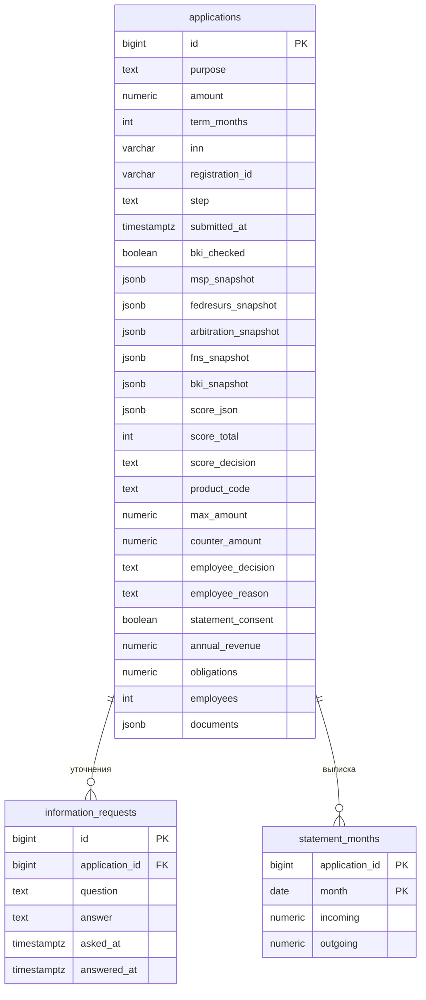

# Модель данных

Один сервер PostgreSQL 16. Базу `ml` создаёт образ Postgres. Базу `registries` и схемы реестров создаёт `src/postgres/initdb` при пустом томе. Схему `portal` создаёт API при первом обращении к заявкам.

`documents` — массив объектов `{ "name", "kind" }`. Содержимого файлов нет.

Снимок реестра пишется в заявку на `registry-check` и дальше не меняется, пока снимок не обновят тем же методом. Карточка компании при открытии заявки читается из снимка, а не заново из реестра.

## Реестры в базе `registries`

Это моки. Имена схем совпадают с папками `src/registries/`.

| Схема | Зачем в процессе |
| --- | --- |
| `egrul` | Юридическое лицо: наименование, ИНН, ОГРН, статус |
| `egrip` | Индивидуальный предприниматель |
| `fns` | Выручка, расходы, численность, налоговая задолженность |
| `msp` | Категория субъекта и признак вновь созданного |
| `fedresurs` | Действующее банкротство и действующий залог |
| `arbitration` | Открытые иски к ответчику и их сумма |
| `bki` | Договоры, код срока платежей, просрочка, блокировка счёта |
| `goods` | Словарь категорий, по которым цель кредита сопоставляется с товарами |

## База `ml`

Таблица `ml.goods_searches`: одна строка на заявку. Статусы `queued`, `running`, `done`, `failed`, `no_categories`. Результаты — JSON со ссылками и ценами. Эта таблица не относится к схеме `goods`.
